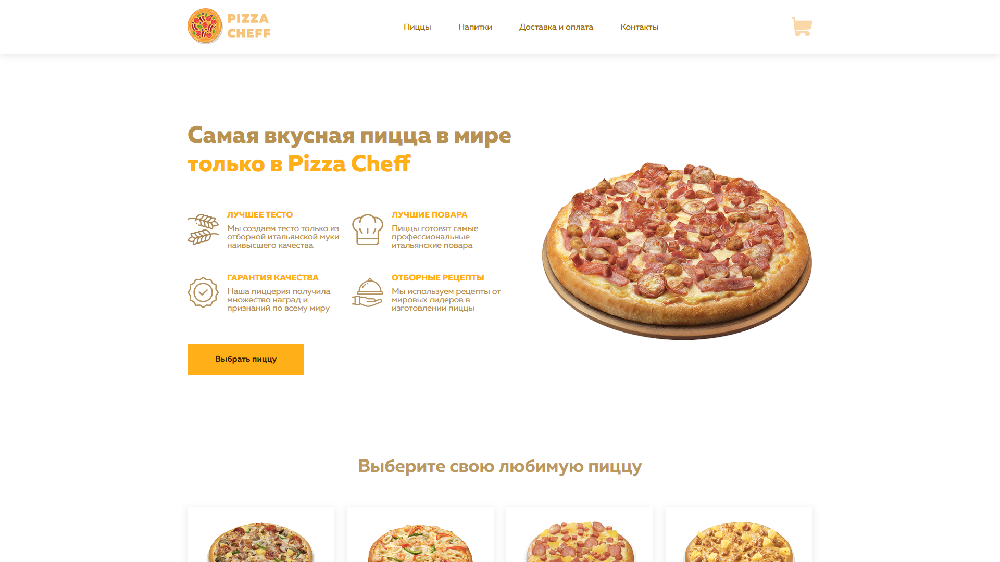
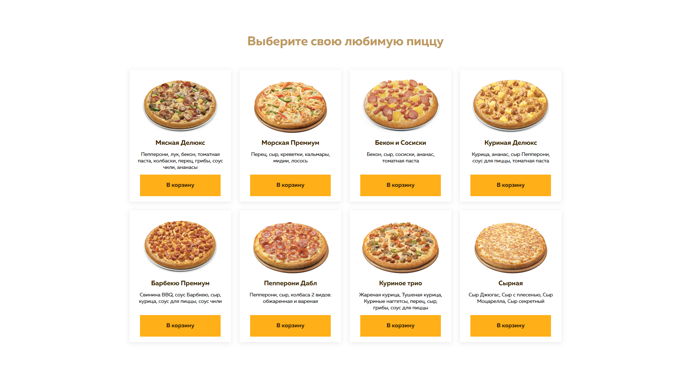
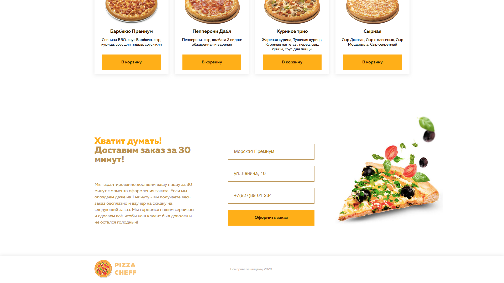
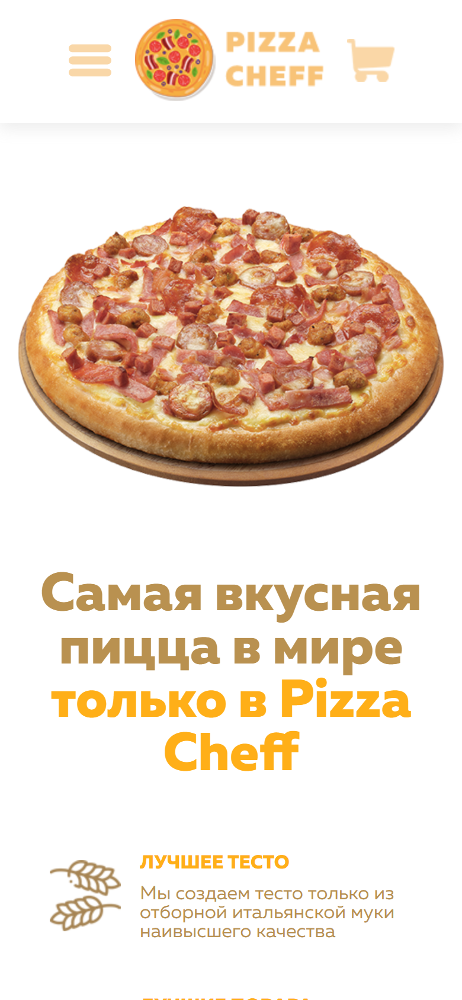
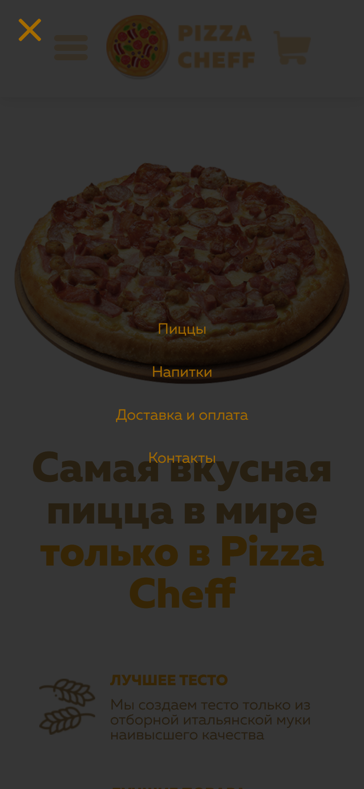

<p align="center">
  
</p>

<p align="center">
  <b>Лендинг пиццерии: меню из 8 пицц, подстановка выбранной пиццы в заказ, проверка формы и маска телефона.</b>
</p>

<p align="center">
  
  
  
  <a href="https://dekciw.github.io/PizzaChef/"></a>
</p>

<p align="center">
  <a href="https://dekciw.github.io/PizzaChef/">
    
  </a>
</p>

<br>

<p align="center">
  
</p>

<br>

<table align="center">
  <tr>
    <th>&#8199;&#8199;&#8199;&#8199;&#8199;&#8199;Меню&#8199;&#8199;&#8199;&#8199;&#8199;&#8199;</th>
    <th>&#8199;&#8199;&#8199;&#8199;&#8199;&#8199;Заказ&#8199;&#8199;&#8199;&#8199;&#8199;&#8199;</th>
    <th>&#8199;&#8199;&#8199;&#8199;&#8199;&#8199;Вёрстка&#8199;&#8199;&#8199;&#8199;&#8199;&#8199;</th>
  </tr>
  <tr>
    <td valign="top">
      - 8 пицц с составом<br>
      - Кнопка «В корзину»<br>
      - Кнопка «Выбрать пиццу»<br>
      - Плавная прокрутка<br>
      - Блок преимуществ<br>
      - Обещание доставки за 30 минут
    </td>
    <td valign="top">
      - Пицца подставляется сама<br>
      - Поле адреса<br>
      - Маска телефона<br>
      - В телефон только цифры<br>
      - Проверка пустых полей<br>
      - Сообщение об успешном заказе
    </td>
    <td valign="top">
      - Адаптив до 320 px<br>
      - Шесть точек адаптива<br>
      - Мобильное меню<br>
      - Шрифт Muller<br>
      - HTML, CSS и JavaScript<br>
      - Сайт на GitHub Pages
    </td>
  </tr>
</table>

<h3 align="center">Как это выглядит</h3>

<table align="center">
  <tr>
    <td width="50%" align="center" valign="top">
      <br>
      <sub>Меню</sub>
    </td>
    <td width="50%" align="center" valign="top">
      <br>
      <sub>Заказ: после «В корзину» пицца подставилась сама</sub>
    </td>
  </tr>
  <tr>
    <td width="50%" align="center" valign="top">
      <br>
      <sub>Мобильная версия</sub>
    </td>
    <td width="50%" align="center" valign="top">
      <br>
      <sub>Мобильное меню</sub>
    </td>
  </tr>
</table>

<br>

<details>
<summary><b>Подробнее о проекте: устройство, запуск</b> (нажми, чтобы развернуть)</summary>

<br>

### Структура

```
.
├── index.html                  # шапка, первый экран, меню пицц, форма заказа и подвал
├── css/
│   ├── style.css               # основные стили
│   └── adaptive.css            # адаптив под 1229, 1023, 767, 656, 424 и 374 px
├── scripts/
│   ├── script.js               # прокрутка, подстановка пиццы, проверка формы, маска телефона
│   └── script-adaptive.js      # открытие и закрытие мобильного меню
├── assets/
│   ├── fonts/                  # шрифт Muller
│   └── images/                 # логотип, иконки и фото пицц
└── screenshots/                # скриншоты для README
```

### Как работает заказ

<p>
- <b>«В корзину»</b> берёт название пиццы из карточки, записывает его в поле формы и плавно прокручивает страницу к заказу<br>
- <b>Телефон</b> принимает только цифры и сам форматируется в вид +7(927)89-01-234<br>
- <b>«Оформить заказ»</b> проверяет, что пицца, адрес и телефон заполнены, и показывает сообщение. На сервер заказ не отправляется
</p>

### Запуск

Сборка не нужна: откройте `index.html` в браузере.

</details>
